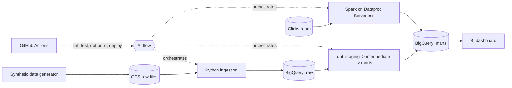

# Fashion EC Data Platform

An end-to-end ELT pipeline for a fashion e-commerce business, built on synthetic data.
It covers orders, returns, inventory snapshots, price history and clickstream events,
and is designed the way a production data platform would be: tested, reviewed,
orchestrated and deployed through CI/CD.

> **Status:** Phase 1 — repository foundation and synthetic data generation.
> See the [roadmap](#roadmap).

## Why this project

Fashion EC has data problems that generic tutorials skip:

- **Size and color variants** make SKU-level inventory and sell-through hard to model.
- **High return rates** mean revenue has to be reported net of returns.
- **Frequent price changes and seasonal markdowns** require history tracking (SCD Type 2).
- **Clickstream volume** grows much faster than order volume.

This project models those problems end to end.
All data is **synthetic**; no real company data is used.

## Architecture



## Tech stack

| Area | Tool | Purpose |
|---|---|---|
| Version control | Git, GitHub | Trunk-based development, PR review, Conventional Commits |
| Testing | pytest | Unit tests, schema checks, DAG import tests |
| CI/CD | GitHub Actions | Lint, test, `dbt build` per PR, automated deploy |
| Transformation | dbt (BigQuery) | Layered modeling, tests, snapshots, docs |
| Orchestration | Airflow | Daily batch, backfill, retries, alerting |
| Large-scale processing | Spark (Dataproc Serverless) | Clickstream sessionization and funnels |
| Cloud | GCP | GCS, BigQuery, IAM, Secret Manager |

## Repository layout

```
.
├── src/fashion_ec/     # Python package: data generation, ingestion, utilities
├── tests/              # pytest tests
├── dbt/                # dbt project (Phase 2)
├── airflow/            # DAGs and Airflow config (Phase 3)
├── spark/              # PySpark jobs (Phase 4)
├── infra/              # Infrastructure as code (Phase 5)
├── docs/
│   ├── adr/            # Architecture Decision Records
│   └── data-model.md   # Source tables and intentional data quirks
├── .github/workflows/  # CI/CD (added in Phase 1, extended later)
├── pyproject.toml      # Package, ruff and pytest configuration
└── tasks.py            # Cross-platform developer commands (install, lint, test, ...)
```

## Getting started

Requires Python 3.11 or later. Works on Windows, macOS and Linux.

**Windows (PowerShell)**

```powershell
py -3.11 -m venv .venv
.venv\Scripts\Activate.ps1
python tasks.py install
python tasks.py check            # lint + tests
```

If PowerShell blocks the activation script, run
`Set-ExecutionPolicy -Scope CurrentUser RemoteSigned` once.

**macOS / Linux**

```bash
python3 -m venv .venv
source .venv/bin/activate
python tasks.py install
python tasks.py check
```

Other commands: `python tasks.py format`, `python tasks.py test`, `python tasks.py clean`.

## Generate synthetic data

```bash
python -m fashion_ec.generate --out data/raw
```

The default is about 20,000 orders, 220,000 clickstream events and 150,000 inventory rows
(a few seconds). The seed is fixed, so the same options always give the same data.
Use `--help` for all options, for example a bigger clickstream for the Spark phase:

```bash
python -m fashion_ec.generate --out data/raw --days 365 --orders 200000 --sessions 2000000
```

The tables and the deliberate "real-world" quirks (UTC vs JST, cancellations, censored
returns, no session id) are described in [`docs/data-model.md`](docs/data-model.md).
Output goes to `data/`, which is git-ignored.

## Windows notes

- **Airflow** does not run natively on Windows. From Phase 3, run it with
  Docker Desktop (WSL2 backend) or inside WSL2.
- **Spark** jobs run on GCP (Dataproc Serverless), so no local cluster is required.
  A small local PySpark setup for development also needs Java 17 and is best used from WSL2.
- Line endings are normalized to LF via `.gitattributes`, so Windows CRLF does not leak
  into the repository.

## Development workflow

- `main` is protected; every change goes through a pull request.
- Commit messages follow [Conventional Commits](https://www.conventionalcommits.org/)
  (`feat:`, `fix:`, `test:`, `docs:`, `chore:`).
- `python tasks.py check` must pass locally before pushing; CI runs the same checks.

## Design decisions

Key decisions are recorded as ADRs in [`docs/adr/`](docs/adr/).

| ADR | Decision |
|---|---|
| [0001](docs/adr/0001-elt-with-dbt-on-bigquery.md) | Use ELT with dbt on BigQuery |

## Roadmap

- [x] **Phase 1** — Repository foundation, tooling, ADRs
- [x] **Phase 1** — Synthetic data generator with tests
- [ ] **Phase 1** — CI: lint and tests on every PR
- [ ] **Phase 2** — dbt models, tests, snapshots
- [ ] **Phase 3** — Airflow DAGs with backfill and retries
- [ ] **Phase 4** — Spark clickstream processing and cost comparison with BigQuery SQL
- [ ] **Phase 5** — CD, dashboard, demo video

## License

MIT
