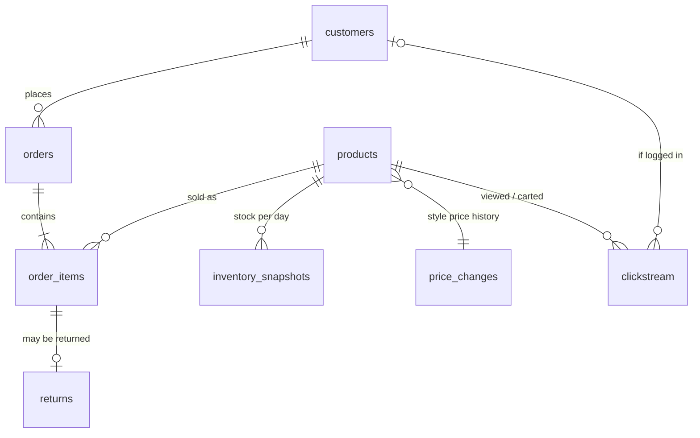

# Source data model

All data is synthetic and generated by `fashion_ec.generate`. These eight tables are the
"raw" layer that Phase 2 (dbt) models on top of.

## Tables

| Table | Grain | Key | Notes |
|---|---|---|---|
| `products` | one row per SKU (style x color x size) | `sku` | `style_id` groups variants. `initial_stock` is the stock on the SKU's first day in the window. |
| `price_changes` | one row per price change per style | `style_id`, `effective_date` | `change_reason` is `launch` or `markdown`. Source for an SCD Type 2 history. |
| `customers` | one row per customer | `customer_id` | Region and acquisition channel. |
| `orders` | one row per order | `order_id` | `status` is `completed` or `cancelled`. `order_ts` is UTC. |
| `order_items` | one row per SKU in an order | `order_item_id` | `unit_price` is the list price in effect on the order's JST date. |
| `returns` | one row per returned order line | `return_id` | Full refund. `reason` depends on whether the item is sized. |
| `inventory_snapshots` | SKU x day | `snapshot_date`, `sku` | End-of-day on-hand units, from launch day onward. |
| `clickstream` | one row per web event | `event_id` | `page_view`, `add_to_cart`, `purchase`. No session id. |

Files are written as Parquet under `data/raw/<table>/`. `clickstream` is partitioned by UTC
event date (`event_date=YYYY-MM-DD`).

## Deliberate "real-world" properties

These are intentional, so later phases have realistic problems to solve:

| Property | Where it matters |
|---|---|
| Timestamps are UTC, but the business day is JST | dbt: convert to JST before grouping by day. Off-by-one-day bugs are easy here. |
| Cancelled orders exist | dbt: revenue and inventory models must filter them out. |
| Returns arrive 3-30 days after the order, and returns after the window are missing | dbt: return rate for recent orders is understated (right-censoring). Report it by cohort. |
| Prices change over time | dbt snapshot: SCD Type 2 on style price. Revenue must use the price at order time. |
| Clickstream has no `session_id` | Spark: sessionize with a 30-minute inactivity gap. |
| Only about a third of visitors are logged in | Spark/dbt: stitch anonymous and customer identities. |
| `customer_id` is null for anonymous events | Tests must allow nulls here and only here. |
| Stock is clipped at zero and nothing is restocked except returns | Sell-through and stock-out analysis. |

## Known simplifications

- Clickstream `purchase` events are not linked to `orders` rows. They only shape the funnel.
- Customers have no personal data (names, emails), so nothing here is PII.
- All returns are full refunds of the whole line.
- Demand does not respond to price or stock level.
