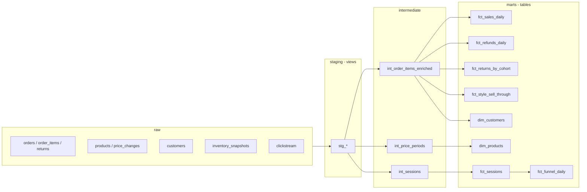

# dbt project

The dbt project in [`dbt/`](../dbt) models the raw tables loaded by `fashion_ec.load`.
It uses `dbt-bigquery`, authenticates with Application Default Credentials and contains no
secrets (see [`gcp-setup.md`](gcp-setup.md) for sign-in).

## Run it (Windows PowerShell)

```powershell
python tasks.py install          # installs dbt-core and dbt-bigquery too
$env:GCP_PROJECT_ID = "YOUR_PROJECT_ID"
cd dbt
dbt debug --profiles-dir .       # checks the connection
dbt build --profiles-dir .       # builds all models and runs all tests
```

| Setting | Environment variable | Default |
|---|---|---|
| GCP project | `GCP_PROJECT_ID` | required |
| Raw dataset (source) | `BQ_RAW_DATASET` | `raw` |
| Output dataset prefix | `DBT_DATASET` | `analytics` |
| Location | `BQ_LOCATION` | `asia-northeast1` |

Models are built into `<DBT_DATASET>_staging`, `_intermediate` and `_marts`. Use a different
`DBT_DATASET` for experiments. The profile also sets `maximum_bytes_billed` to 1 GB, so a
runaway query fails instead of being billed.

Useful commands: `dbt build --select stg_orders+` (a model and everything after it),
`dbt build --select +fct_sessions` (a model and everything before it),
`dbt test --select fct_returns_by_cohort`, `dbt ls --resource-type test`.

Project variables (`dbt_project.yml`), changeable per run with
`--vars '{session_gap_minutes: 15}'`:

| Variable | Default | Meaning |
|---|---|---|
| `session_gap_minutes` | 30 | Inactivity that ends a web session |
| `return_window_days` | 30 | Days after an order in which returns can still arrive |
| `sell_through_days` | 30 | Window after launch for the sell-through KPI |

## Layers and models



| Layer | Models | Rule |
|---|---|---|
| staging (8 sources) | `stg_*`, one per raw table | Renames and light cleanup only, no joins. Views. |
| intermediate | `int_order_items_enriched`, `int_price_periods`, `int_sessions` | Reusable joins and logic. Views, except `int_sessions` (table). |
| marts | `dim_products`, `dim_customers`, `fct_sales_daily`, `fct_refunds_daily`, `fct_returns_by_cohort`, `fct_sessions`, `fct_funnel_daily`, `fct_style_sell_through` | What people query. Tables. |

19 models in total.

### Conventions

- Names carry the unit: `_jpy` for yen, `_units` for counts, `_at` for UTC timestamps and
  `_on_jst` for business dates in Japan time.
- Business dates are always made with `{{ jst_date('column') }}`. Calling `date()` on a UTC
  timestamp puts orders placed between 00:00 and 08:59 JST on the previous day.
- Cancelled orders never count as sales; they stay in the data with `is_cancelled`.

### The three non-obvious models

**`int_price_periods`** turns the price change log into validity periods
(`valid_from <= date < valid_to`, `valid_to` null for the current price) with a window
function. `assert_order_price_matches_price_period` checks that every order line was sold at
the price valid on its order date. See ADR 0005 for why this is not a dbt `snapshot`.

**`int_sessions`** derives web sessions. A visitor's session ends when 30 minutes pass without
an event (`session_gap_minutes`): exactly 30 minutes stays in the same session, one second more
starts a new one. The session id is the visitor id plus a running number.

**`fct_returns_by_cohort`** reports the return rate by order month. Returns arrive up to 30
days after the order, so the newest month always looks better than it is (in the default data
about 8% against about 20% for finished months). `is_mature` marks months whose whole return
window has passed; compare only those.

## Tests

154 generic tests (unique, not null, accepted values, relationships between tables, positive
or non-negative amounts, values between bounds, unique column combinations) and 11
business-rule tests, 165 in all.

| Test | Rule |
|---|---|
| `assert_no_returns_for_cancelled_orders` | A cancelled order never shipped |
| `assert_returns_happen_after_the_order` | A return follows its order |
| `assert_refund_equals_line_amount` | Returns are full refunds |
| `assert_nothing_sold_before_launch` | A SKU is sold on or after its launch date (JST) |
| `assert_every_style_has_one_launch_price` | Price history starts with exactly one launch row |
| `assert_one_current_price_per_style` | Exactly one current price period per style |
| `assert_order_price_matches_price_period` | Each line was sold at the price valid on its order date |
| `assert_sales_reconcile_with_staging` | Total sales in the mart equal the lines in staging |
| `assert_refunds_reconcile_with_staging` | Total refunds in the mart equal the returns in staging |
| `assert_every_event_belongs_to_a_session` | No event is lost or duplicated in sessions |
| `assert_funnel_is_monotonic` | A purchase needs a cart, a cart needs a view, in one session |

## Checks that need no BigQuery

`dbt build` needs a warehouse, so CI checks the project in three ways without one:

1. **Static checks** (`tests/test_dbt_models.py`): every model is rendered, parsed as BigQuery
   SQL and checked against the raw schema and its upstream models; every model must be
   documented, with a uniqueness test. `dbt parse --warn-error` runs as its own CI job.
2. **Execution** (`tests/test_dbt_execution.py`): the BigQuery SQL is translated to DuckDB and
   run on freshly generated data. All 165 data tests are executed, and the marts are compared
   with a second implementation written in pandas (sales, customers, return cohorts, refunds,
   sessions, funnel, sell-through, current prices).
3. **Boundary cases**: sessions with hand-made events (exactly 30 minutes, 30 minutes and one
   second, a session crossing midnight in Japan, a changed `session_gap_minutes`).

These checks were verified by breaking the models on purpose: dropping the time zone,
changing `>` to `>=` in the session rule, letting cancelled orders into sales and widening a
price period each made the tests fail.

What they cannot prove: that BigQuery behaves exactly like DuckDB (for example BigQuery
truncates `timestamp_diff` to whole seconds, DuckDB counts boundaries; the tests allow one
second there). `dbt build` on BigQuery has the final word.

## Troubleshooting

| Symptom | Likely cause |
|---|---|
| `Env var required but not provided: 'GCP_PROJECT_ID'` | Set `$env:GCP_PROJECT_ID` in the same PowerShell window. |
| `Your default credentials were not found` | Run `gcloud auth application-default login`. |
| `Not found: Dataset ...:raw` | Load the raw data first: `python -m fashion_ec.load --sandbox`. |
| `Not found: Table ...raw.<table>` after a while | Sandbox tables expire after 60 days; run the loader again. |
| `Access Denied: ... bigquery.jobs.create` | The signed-in account has no access to the project. |
| Dataset location error | The raw dataset and `BQ_LOCATION` must match (`asia-northeast1`). |
| `Query exceeded limit for bytes billed` | A query would scan over 1 GB (`maximum_bytes_billed`); filter it or raise the limit on purpose. |
